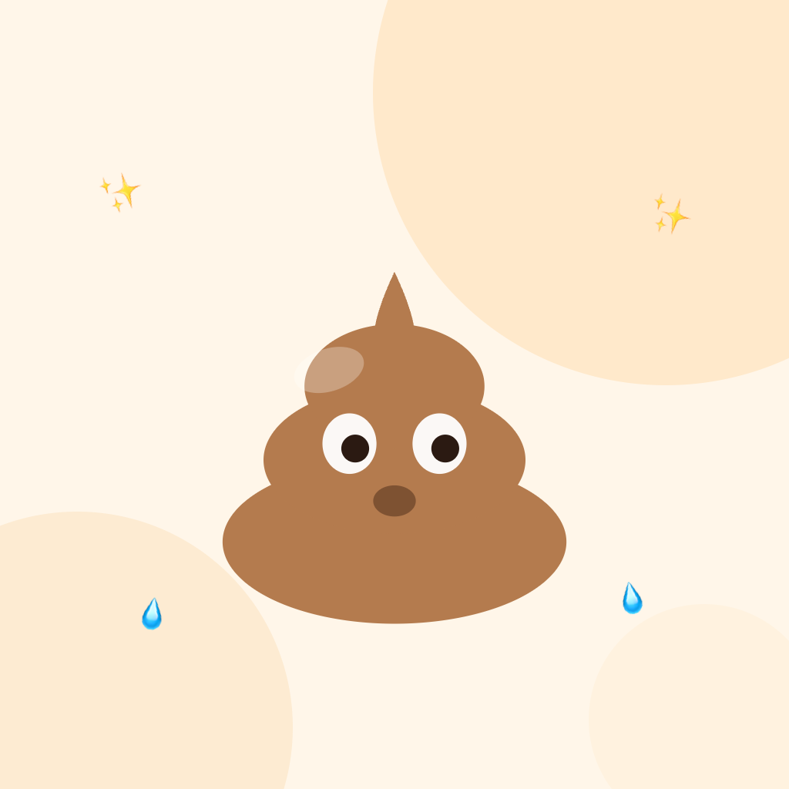
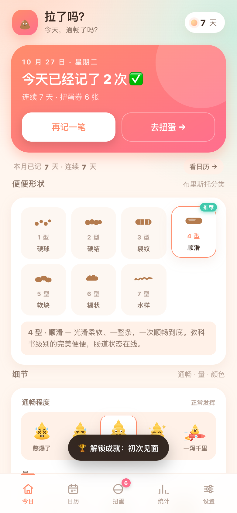
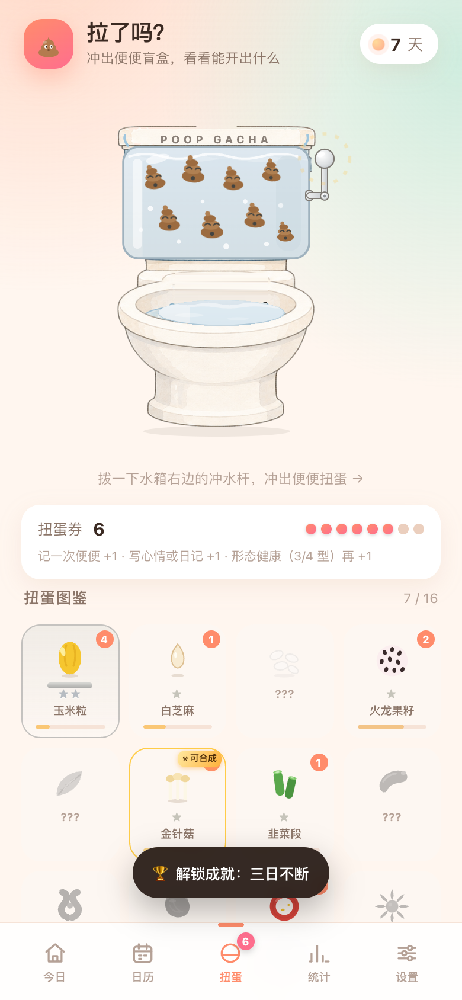
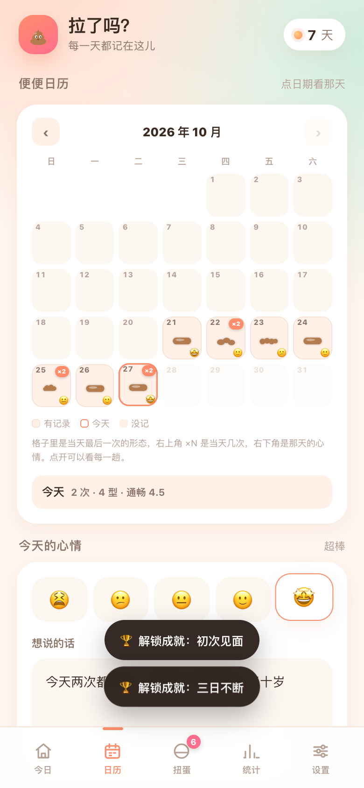

<p align="center">
  
</p>

<h1 align="center">拉了吗？</h1>

<p align="center">一个认真记录肠道健康的小本子，把每天最不好意思聊的事，变成一颗扭蛋。</p>

<p align="center">
  <a href="https://la-ma-le-pooplog.app.workbuddy.host/?sharecode=VA3KC6OBQV">在线体验</a> ·
  原生 HTML / CSS / JS · 零依赖 · 零后端 · 数据只存在自己手机里
</p>

<p align="center">
  
  
  
</p>

---

## 这是什么

「拉了吗？」是一个便便记录工具。每天拉完，像选表情包一样选个形状，顺手记通畅度、量、颜色，就能攒一张扭蛋券；拨一下水箱上的冲水杆，一只带表情的便便划着抛物线砸到屏幕上，裂开蹦出「没消化的食物残渣」。

做成这样是因为：正经的健康记录太像填表，坚持不下去。把它变成每天一次的小抽奖，反而能一直记下去——而连续记录本身，才是这个工具真正的价值。

## 功能

- **今日**：布里斯托 7 型形状选择、通畅度、量、颜色、20 秒语音感悟；一天可以记多趟，日历会把它们连成一条线
- **日历**：整月一眼看完，浅色格子里直接显示形态和心情；点任意过去日期可以**补记**，补记计入统计但不发券
- **扭蛋**：冲水杆动画 + 现场合成的**三幕马桶冲水声**（咔哒 → 漩涡 → 咕噜与补水）；20 多种残渣、隐藏款「金针菇之王」，重复的可以合成白银 / 黄金档
- **统计**：连续天数、形态分布、通畅度趋势
- **分享图**：把当天带便便情况的一页导出成图片
- **设置**：品牌名与副标题、扭蛋机外观切换、数据导出 / 导入、关于

## 快速开始

不需要 npm、不需要构建、不需要后端。

```bash
git clone https://github.com/weishenmeyaa-debug/la-ma-le.git
cd la-ma-le
python3 -m http.server 8080
# 浏览器打开 http://localhost:8080
```

也可以直接双击 `index.html`，但部分浏览器在 `file://` 下会限制本地存储，建议用上面的本地服务器方式。

## 技术说明

| 项目 | 实现 |
| --- | --- |
| 界面 | 原生 HTML + CSS，无框架、无构建步骤 |
| 图形 | 全部 SVG 手绘（便便、马桶、拉杆、残渣、分享图），`toilet-ref.png` 是马桶本体素材 |
| 动画 | CSS keyframes（拉杆 1.3s 完整周期、球头放大、红框引导） |
| 音效 | WebAudio 实时合成，不加载任何音频文件 |
| 存储 | `localStorage`（`pooplog.v1`）；写入超配额时自动剥离语音数据重试，彻底不可写时降级为内存模式 |
| 平台适配 | 检测到小红书小工具容器时，自动切换平台 Storage、保存到相册、发布笔记与震动能力 |

单页应用，所有逻辑在 `app.js` 里，样式在 `styles.css` 里，入口是 `index.html`。改完刷新即可看到效果。

## 数据与隐私

- 所有记录**只存在你自己的浏览器 / 手机里**，不上传、不联网、没有账号体系，作者这边看不到任何数据
- 在「设置」里可以导出 JSON 备份、再导入回来
- 清理浏览器数据、换设备、卸载会丢记录，重要数据请先导出
- 锁定 `localStorage` 的环境（某些内嵌 WebView）会自动降级为内存模式，刷新后不保留，属预期行为

## 免责声明

这个工具只是**自我观察工具**，不能替代医生诊断。布里斯托分类在此仅用于记录形态，不构成任何判断或建议。出现黑便、便血、形态突然变细、长期便秘或腹泻等情况，请及时就医；已确诊肠道疾病、需要专业饮食管理的朋友请遵医嘱。

## 目录结构

```
.
├── index.html              入口
├── app.js                  全部交互逻辑
├── styles.css              样式与动画
├── toilet-ref.png          马桶本体素材（代码直接引用，请勿移动）
├── docs/screenshots/       界面截图
├── LICENSE                 MIT
└── README.md
```

## 关于

WorkBuddy 1024 造物挑战参赛作品 · 制作者：芝士加倍

以 MIT 协议开源，随便玩，改坏了别找我。

---

> 今天，通畅了吗？
